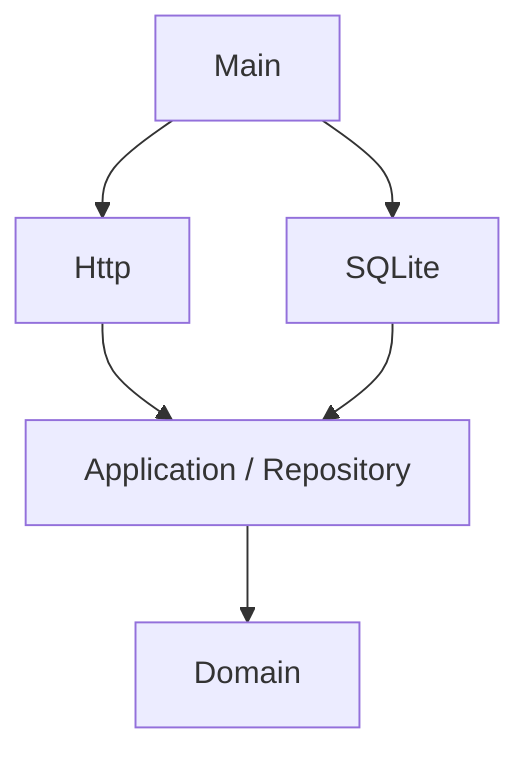

# Lean Todo API 設計

## API

Lean 4 で動くローカル向けの JSON API。Todo は ID、タイトル、完了状態を持つ。新規作成時は未完了。タイトルは前後の ASCII 空白を除いたうえで 1〜200 文字とする。

完了済みの Todo はタイトルを変更したり、未完了に戻したりできない。削除はできる。

| メソッド | パス | 成功時 |
| --- | --- | --- |
| GET | /health | 200、起動確認 |
| GET | /todos | 200、ID 昇順の一覧 |
| POST | /todos | 201、新規 Todo と Location ヘッダー |
| GET | /todos/{id} | 200、指定した Todo |
| PUT | /todos/{id} | 200、未完了の Todo のタイトルと完了状態を置き換える |
| DELETE | /todos/{id} | 204、応答本文なし |

入力不正は 400、リクエスト本文が 16 KiB を超える場合は 413、存在しない ID は 404、既知のパスに対する未対応メソッドは 405。
完了済みの Todo への PUT や、読み込みから保存までの間に完了または削除された Todo への PUT は 409。

## 構成

- `Domain` は Todo、タイトルの検証、編集できる条件を定義する。
- `Application` は永続化ポート `Repository` とユースケースを定義する。入出力の概形は `create : Repository → String → IO (Except String Todo)`。
- `Http` は HTTP と JSON をユースケースの入出力へ変換する。
- `SQLite` は永続化ポートを実装する。
- `Main` は両アダプターの接続、構成、起動を担当する。

### モジュールの依存方向

矢印は依存元から依存先へ向かう。`Main` が HTTP と SQLite のアダプターを接続し、SQLite アダプターは `Application` が定義する `Repository` を実装する。

HTTP ハンドラーから直接 SQL を実行する案はファイル数が少ない。永続化ポートを定義する案は、入力検証とユースケースを HTTP および SQLite から独立させられるため、こちらを採用する。

## 永続化

SQLite にテーブルを作成し、書き込みと結果の取得は単一の SQL 文で実行する。アダプターは SQLite CLI を引数配列で起動する。タイトルは UTF-8 の 16 進リテラル、ID は検証済みの整数として SQL に渡す。Docker では名前付きボリュームに DB を保存する。

更新時は `Application` が現在の Todo に対してドメインの編集ルールを確認する。SQLite は読み込み時の完了状態と一致するときだけ更新するため、同時更新で完了した Todo を上書きしない。

初期版はローカル利用を想定し、認証・TLS・一覧のページ分割は対象外。既定のバインド先と Docker の公開先はループバックにする。
